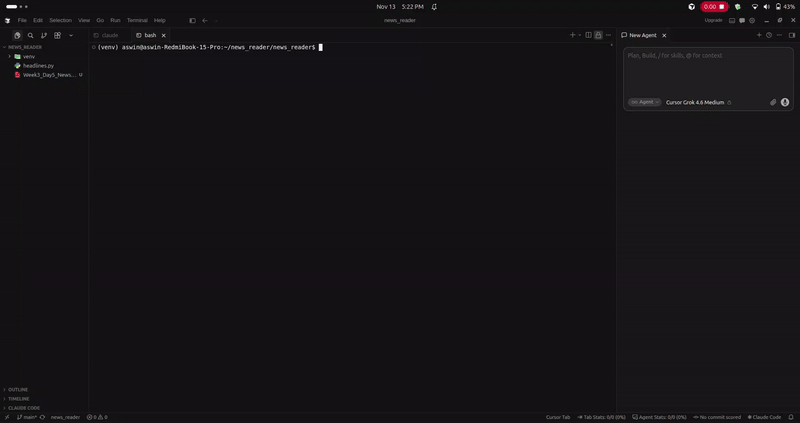
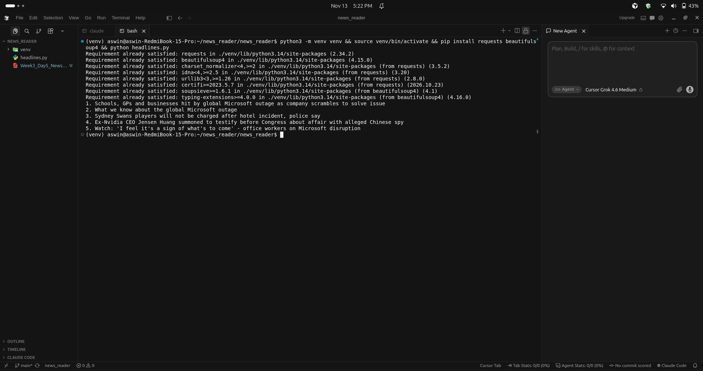

# News Headlines Scraper

A small Python script that fetches the [BBC News](https://www.bbc.com/news) front page and prints the **top 5 headlines** to the terminal.

Built for Social Eagle, Week 3 · Day 5.

## Demo



## Output



## How it works

1. Fetches the page with `requests`, sending a normal `User-Agent` header, and exits if the status code is not 200.
2. Parses the HTML with `BeautifulSoup`.
3. Selects headlines with `<h2 data-testid="card-headline">`, found by inspecting the page. A plain `h2` would also pick up section titles.
4. Strips whitespace and skips empty or duplicate entries.
5. Prints exactly 5 numbered headlines. If fewer than 5 are found, it says how many it found instead of crashing.

## Setup

```bash
python3 -m venv venv
source venv/bin/activate        # Windows: venv\Scripts\Activate.ps1
pip install requests beautifulsoup4
```

## Run

```bash
python headlines.py
```

Example output:

```
1. Schools, GPs and businesses hit by global Microsoft outage as company scrambles to solve issue
2. What we know about the global Microsoft outage
3. Sydney Swans players will not be charged after hotel incident, police say
4. Ex-Nvidia CEO Jensen Huang summoned to testify before Congress about affair with alleged Chinese spy
5. Watch: 'I feel it's a sign of what's to come' - office workers on Microsoft disruption
```

## Notes

- The selector depends on BBC's current markup. If BBC changes it, update the `data-testid` value in `headlines.py`.
- The headlines are in the server-rendered HTML, so no JavaScript rendering is needed.

## Tech

Python · requests · BeautifulSoup4
